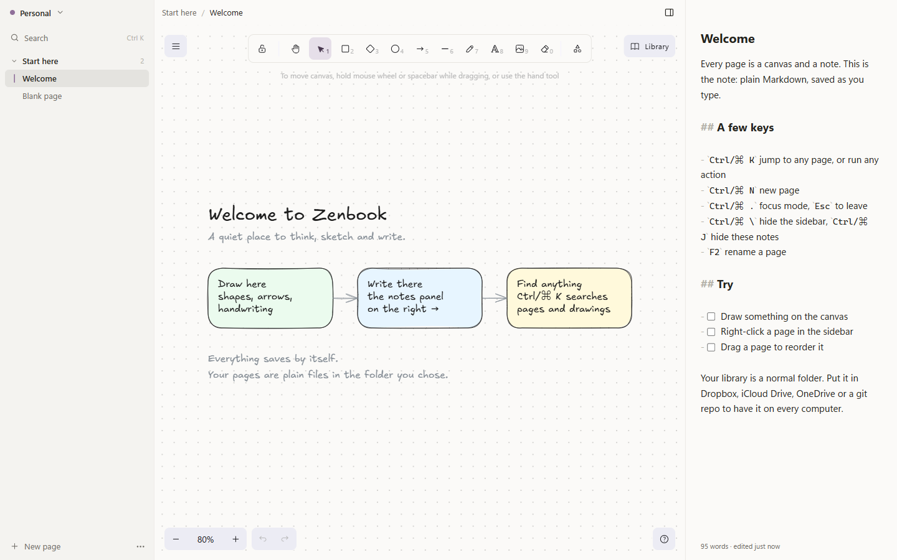
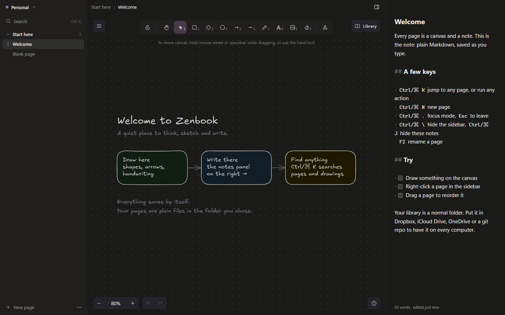
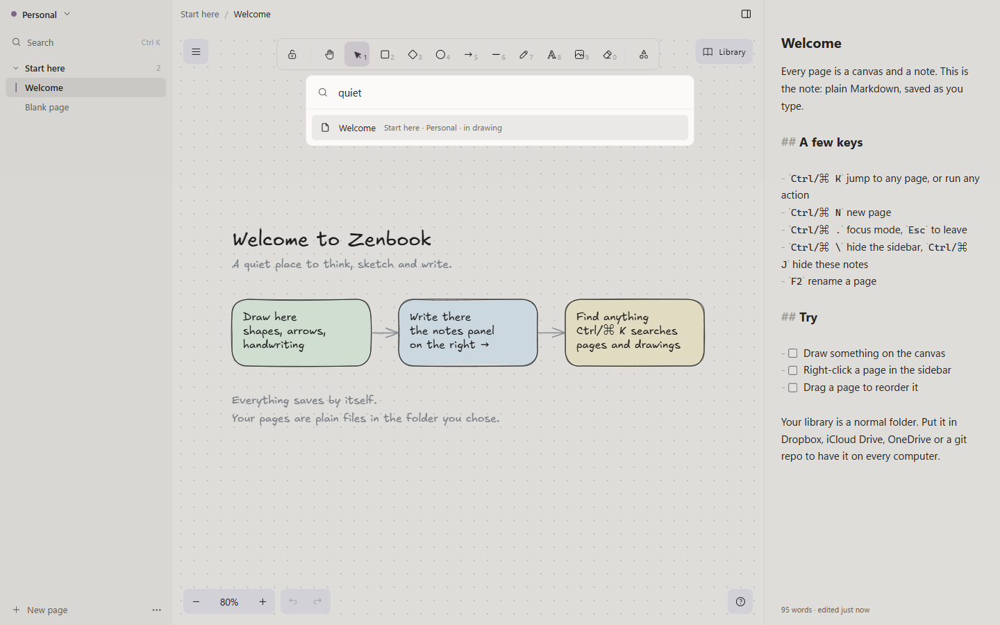

# Zenbook

A calm, local-first notebook for Windows, macOS and Linux. Every page is an
[Excalidraw](https://excalidraw.com) canvas with a Markdown note beside it, organised as
**Spaces › Chapters › Pages**.



## Why Zenbook

- **The canvas is the hero.** One quiet sidebar, one notes panel, nothing else. Focus mode
  (`Ctrl/⌘ .`) hides even those.
- **Your files, your folder.** Pages are standard `.excalidraw` files with a `.md` note next to
  them, in a folder you choose. They open on excalidraw.com and sync with Dropbox, iCloud
  Drive, OneDrive, Syncthing or git. If a page changes on another device while you're
  editing it, both versions are kept.
- **Never lose a stroke.** Everything saves by itself, with crash-safe writes.
- **Find anything.** `Ctrl/⌘ K` searches page titles, notes and the text inside drawings.
- **Fast and small.** One canvas, no background services, works fully offline.
- **Private.** No account, no telemetry. The only network request is the update check, which
  you can turn off.

| Dark mode                                  | Command palette                                            |
| ------------------------------------------ | ---------------------------------------------------------- |
|  |  |

## Install

Download the latest release for your system from
[Releases](https://github.com/abhideepghosh/zenbook/releases/latest):

| System                         | File                                                | Updates                                                                                  |
| ------------------------------ | --------------------------------------------------- | ---------------------------------------------------------------------------------------- |
| Windows (x64 or ARM)           | `Zenbook-<version>-win-<arch>.exe`                  | Automatic                                                                                |
| macOS (Apple silicon or Intel) | `Zenbook-<version>-mac-<arch>.dmg`                  | Automatic once builds are signed; until then the app tells you when a new version is out |
| Linux                          | `Zenbook-<version>-linux-x86_64.AppImage` or `.deb` | AppImage: automatic. `.deb`: download the new version                                    |

**Early builds are not code-signed yet**, so your system will warn you the first time:

- **Windows:** "Windows protected your PC" → _More info_ → _Run anyway_.
- **macOS:** open the app once, then _System Settings → Privacy & Security_ → _Open Anyway_.
- **Linux (AppImage):** make it executable first: `chmod +x Zenbook-*.AppImage`.

## Using Zenbook

| Action                         | Windows / Linux     | macOS         |
| ------------------------------ | ------------------- | ------------- |
| Search pages or run any action | `Ctrl K`            | `⌘ K`         |
| New page                       | `Ctrl N`            | `⌘ N`         |
| Previous / next page           | `Ctrl Alt ↑ / ↓`    | `⌘ ⌥ ↑ / ↓`   |
| Switch Space                   | `Ctrl 1…9`          | `⌘ 1…9`       |
| Hide sidebar / notes           | `Ctrl \` / `Ctrl J` | `⌘ \` / `⌘ J` |
| Focus mode                     | `Ctrl .`            | `⌘ .`         |
| Rename                         | `F2`                | `F2`          |

Right-click any page or chapter for more: duplicate, pin, move, show in folder, delete (with
undo). Drag pages to reorder them, or drop `.excalidraw` files onto a chapter to import them.

### Where your notes live

```text
Zenbook/
  zenbook.json                  library format and Space order
  library.excalidrawlib         your Excalidraw shape library
  Personal/                     a Space
    space.json
    .assets/                    images, stored once each
    Start here/                 a Chapter
      chapter.json              page order
      Welcome.excalidraw        the drawing (opens on excalidraw.com)
      Welcome.md                the note (plain Markdown)
```

Rename or move files in your file manager and Zenbook follows along. Deleted pages go to
your system's Recycle Bin or Trash.

## Development

Requires Node.js 22.12 or newer.

```sh
npm install
npm run dev        # run the app with hot reload
npm run check      # lint, typecheck, unit tests and end-to-end tests
```

| Command                                                       | What it does                                         |
| ------------------------------------------------------------- | ---------------------------------------------------- |
| `npm run dev`                                                 | Start the app in development mode                    |
| `npm run build`                                               | Build main, preload and renderer into `out/`         |
| `npm run lint` / `npm run typecheck`                          | ESLint / strict TypeScript                           |
| `npm test`                                                    | Unit tests (Vitest)                                  |
| `npm run e2e`                                                 | Build, then end-to-end tests (Playwright)            |
| `npm run fixture -- --pages 1000 --elements 2000 --out <dir>` | Generate a large library for performance testing     |
| `npm run dist`                                                | Build installers for the current system into `dist/` |

Releasing a new version (and setting up signing) is explained step by step in
[docs/RELEASING.md](docs/RELEASING.md).

The product spec and architecture are in [docs/SPEC.md](docs/SPEC.md). Contributions are
welcome; see [CONTRIBUTING.md](CONTRIBUTING.md).

## Privacy

Zenbook has no account and sends no analytics. It only contacts GitHub to check for
updates (turn this off under _… → Check for updates automatically_). Links you open from a
drawing open in your browser.

## License

[MIT](LICENSE). Zenbook is built on [Excalidraw](https://github.com/excalidraw/excalidraw)
(MIT) and [CodeMirror](https://codemirror.net) (MIT).

## Author

Created by [Abhideep Ghosh](https://www.linkedin.com/in/abhideep-ghosh/).
